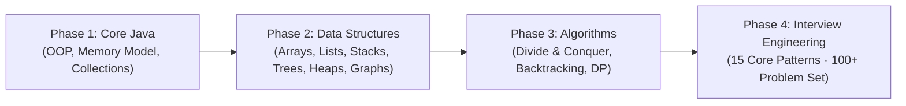

# Java + DSA Curriculum & Interview Engineering Suite

> **Source Repository:** [github.com/Pradeep-B28/JAVA-DSA-Roadmap](https://github.com/Pradeep-B28/JAVA-DSA-Roadmap)  
> **Author & Trainer:** [B Pradeep](https://github.com/Pradeep-B28) · [Portfolio](https://pradeep-b28.github.io/Pradeep-B28/)

---

## Overview

A structured, end-to-end curriculum for mastering Core Java (OOP, memory model, concurrency, collections internals) and Data Structures & Algorithms. Designed and refined across **4 years** and **7,500+ mentored engineers and students** at institutions including VIT Chennai, VIT Vellore, VIT-AP, and Sethu Institute of Technology.

Features fully compilable standalone Java implementations, 15 core interview problem-solving pattern templates, and a curated 100+ LeetCode roadmap.



---

## Curriculum Structure

| Phase | Focus Domain | Key Topics & Standalone Modules |
| :--- | :--- | :--- |
| **01 Core Java** | Fundamentals & JVM | `Basics.java` (Primitives vs. References), `OOPsDemo.java` (Polymorphism, Abstraction), `CollectionsGuide.java` (`HashMap` bucket mechanics, `PriorityQueue`) |
| **02 Data Structures** | Fundamental & Hierarchical | `ArrayOperations.java` (Two pointers, Sliding window), `LinkedListDemo.java` (Floyd's cycle detection), `StackQueueDemo.java`, `BinaryTreeDemo.java` (Traversals & BST), `HeapDemo.java` (Sift-up/down), `GraphDemo.java` (BFS, DFS, Dijkstra) |
| **03 Algorithms** | Optimization & Complexity | `SortingAlgorithms.java` (Merge Sort, Quick Sort), `RecursionBacktrackingDemo.java` (Subsets, Permutations, N-Queens), `DynamicProgrammingDemo.java` (Knapsack, Coin Change, Tabulation) |
| **04 Interview Prep** | Algorithmic Problem Solving | `Patterns.md` (Top 15 Problem Solving Patterns), `Problem-Set.md` (100+ curated interview problems categorized by pattern and tier) |

---

## Top 15 Algorithmic Patterns Covered

1. **Two Pointers:** Opposite-directional scans, palindrome verification, trapped rainwater.
2. **Sliding Window:** Dynamic vs. fixed length windows, maximum sum subarrays, longest substring without repeats.
3. **Fast & Slow Pointers:** Floyd's cycle detection in linked lists and arrays.
4. **Merge Intervals:** Interval collision detection, room allocation scheduling.
5. **Cyclic Sort:** $O(N)$ time and $O(1)$ space for finding missing/duplicate numbers in contiguous ranges.
6. **In-place Reversal of LinkedList:** Sub-list reversal with zero heap reallocations.
7. **Tree Breadth-First Search (BFS):** Level-order traversals, zigzag paths, minimum depth.
8. **Tree Depth-First Search (DFS):** Path sums, diameter of binary tree, lowest common ancestor.
9. **Two Heaps Pattern:** Median of continuous data streams.
10. **Subsets & Backtracking:** Power sets, combinatorial pruning, state-space exploration.
11. **Modified Binary Search:** Order-agnostic search, rotated sorted array boundaries.
12. **Top-K Elements:** Priority queue selection in $O(N \log K)$ time.
13. **K-way Merge:** Merging sorted streams and lists.
14. **0/1 Knapsack & Unbounded DP:** Memoization tables, state space compression.
15. **Topological Sort (Kahn's Algorithm):** Dependency resolution and cycle detection in DAGs.

---

## Standalone Compilation & Execution

All modules in this repository are pure, self-contained Java source files requiring zero third-party dependencies:

```powershell
# Clone the repository
git clone https://github.com/Pradeep-B28/JAVA-DSA-Roadmap.git
cd JAVA-DSA-Roadmap

# Compile and run Stacks & Queues Demo
javac 02-Data-Structures/03-Stacks-and-Queues/StackQueueDemo.java
java -cp 02-Data-Structures/03-Stacks-and-Queues StackQueueDemo

# Compile and run Binary Heap Demo
javac 02-Data-Structures/05-Heaps-and-PriorityQueue/HeapDemo.java
java -cp 02-Data-Structures/05-Heaps-and-PriorityQueue HeapDemo

# Compile and run Graph Traversals & Dijkstra Shortest Path
javac 02-Data-Structures/06-Graphs/GraphDemo.java
java -cp 02-Data-Structures/06-Graphs GraphDemo

# Compile and run Dynamic Programming Suite
javac 03-Algorithms/03-Dynamic-Programming/DynamicProgrammingDemo.java
java -cp 03-Algorithms/03-Dynamic-Programming DynamicProgrammingDemo
```

---

## Author & Mentorship

**B Pradeep**  
Technical Trainer – Academic Excellence, Sethu Institute of Technology  
*Trained 7,500+ engineers across VIT Chennai, VIT Vellore, VIT-AP, and KSR.*  
- Email: [pradeepbashaa@gmail.com](mailto:pradeepbashaa@gmail.com)  
- LinkedIn: [linkedin.com/in/pradeepb-2k](https://www.linkedin.com/in/pradeepb-2k)  
- LeetCode: [leetcode.com/u/PradeepKrishB](https://leetcode.com/u/PradeepKrishB/)  
- Portfolio: [pradeep-b28.github.io/Pradeep-B28](https://pradeep-b28.github.io/Pradeep-B28/)

---

## License

This curriculum and source code are released under the [MIT License](LICENSE).
